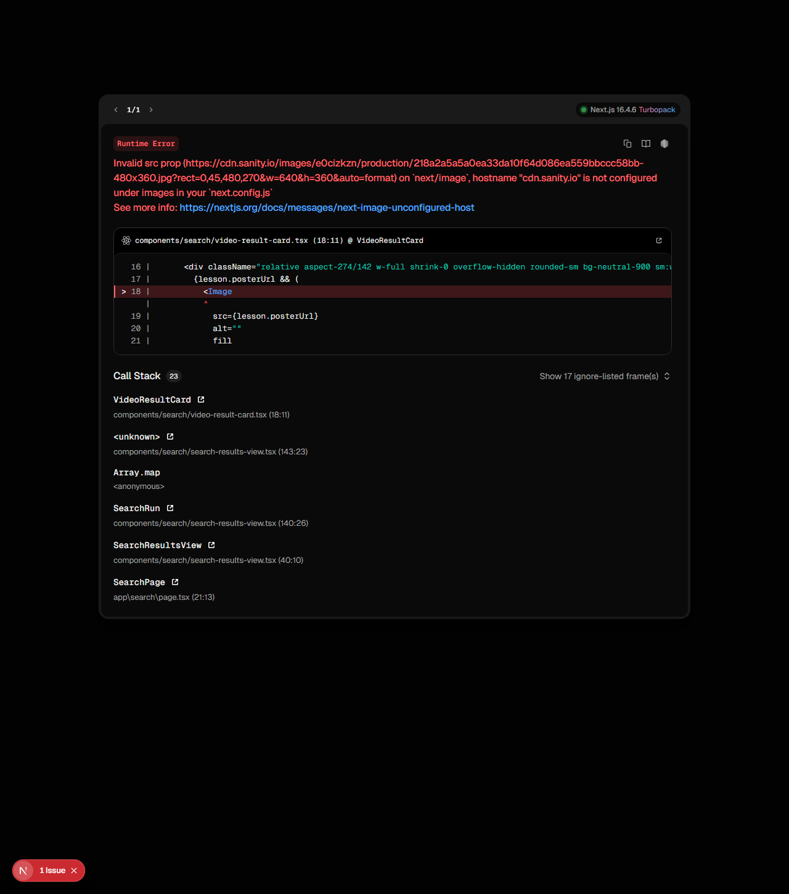
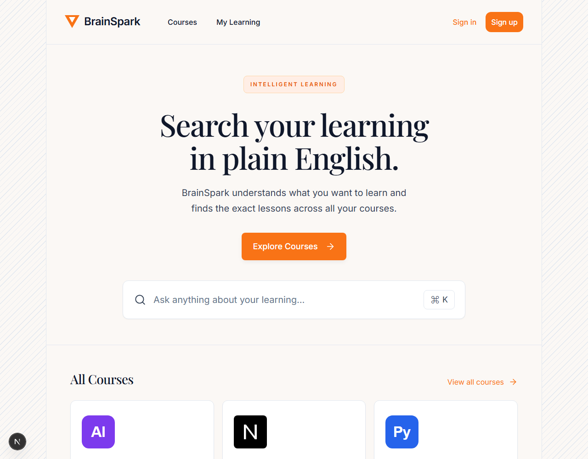
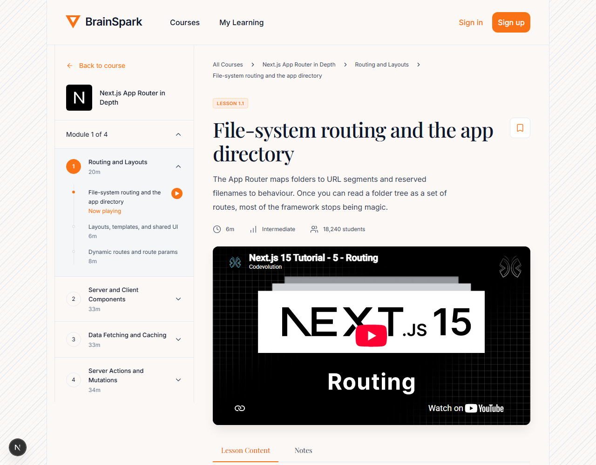
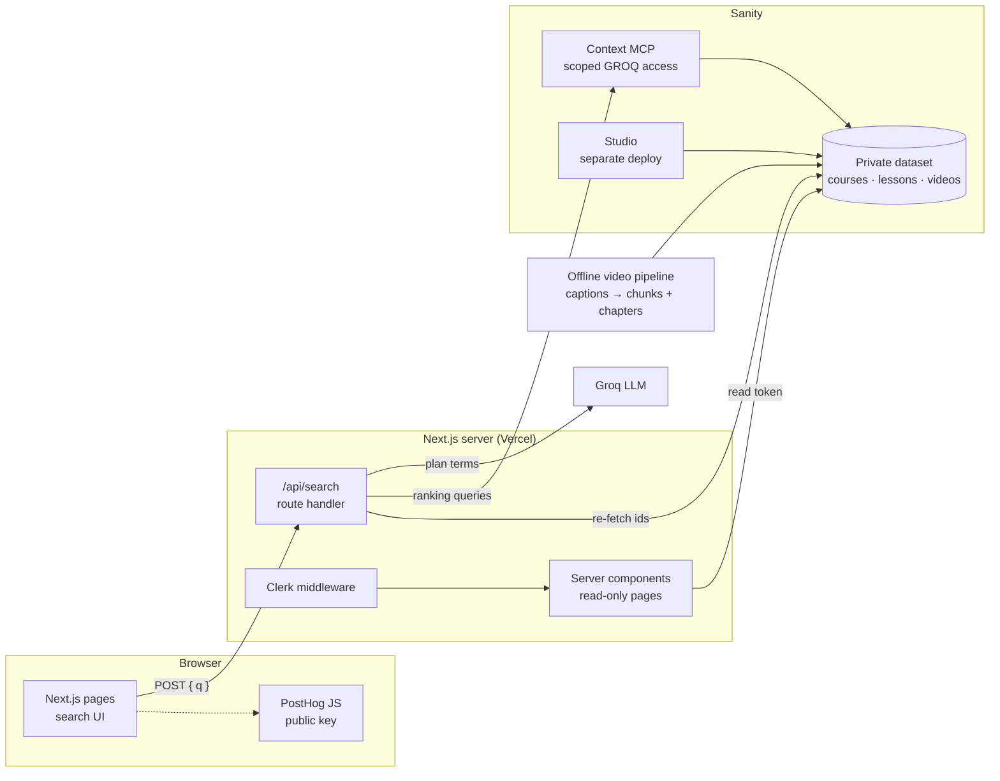

# BrainSpark

**A learning platform where you search your courses in plain English and land on the exact second a topic is taught.**

Type "how does routing work in Next.js" and BrainSpark returns ranked result cards. A video result opens the lesson and starts the embedded video at the matching chapter. A lesson result opens the lesson's notes. Every result comes from stored content, so the AI never invents a course, lesson, or timestamp.

**Live demo:** [brainspark.vercel.app](https://brainspark.vercel.app)



| Home | Lesson (video starts at the matched chapter) |
| --- | --- |
|  |  |

## How search works

Search is a full results page, not a chatbot. One request goes through these steps:

1. **Understand the query.** One call to a Groq-hosted LLM turns the query into word stems: a *primary* concept ("rout") and *supporting* terms. The model writes no queries and none of the text the learner sees.
2. **Build the query on the server.** The server cleans the stems and builds weighted GROQ queries itself. A title that names the exact concept outranks a passing mention in the notes.
3. **Search lessons and video moments together** through the Sanity Context MCP:
   - **Lessons** match on title, key points, and the plain text of their Portable Text notes.
   - **Video moments** match chapter titles first, and fall back to the timestamped transcript. A match at 0:00 is usually the video's intro, so a later match is preferred.
4. **Merge and rank.** Each lesson appears once. A lesson with a matching moment becomes a **video card** ("Watch from 6:10"); otherwise it's a **lesson card**. A transcript-only hit never qualifies a lesson on its own, because transcripts are noisy.
5. **Ground the results.** Every lesson id is re-fetched from Sanity with a parameterised query, and timestamps are checked against the lesson's length. Cards show only stored data.

Results stream back as NDJSON: status lines ("Searching lessons and videos…") and then the results. The page shows a count across courses, a sort control, an empty state, and a link to the full catalog.

### Video intelligence

An offline pipeline (`studio/scripts/videos/`) builds one `video` document per lesson video. Each document holds the chapter list and the transcript, split into short timestamped chunks of about 20–30 s, cut at pauses. A query only ever returns the single matching chapter or chunk, never a whole transcript. Videos play on the site through the provider's own embed (YouTube, Vimeo, or Bunny), using the provider's start parameter (`?t=` on the lesson URL).

## Architecture



**The rules behind it:**
- The browser never holds a token and never calls Sanity, the MCP, or the LLM. It only calls `/api/search`.
- The dataset is private. The read token, Context org token, Groq key, and Clerk secret are server-only.
- The Studio and the web app are separate workspaces with independent deploys. The Studio is not embedded in Next.js.
- Video documents are an internal lookup. They are never shown as results on their own.

## Tech stack

| | Used for |
| --- | --- |
| **Next.js 16** (App Router, Cache Components, Turbopack) | Pages, server data fetching, the streaming search route |
| **Sanity** (Studio, GROQ, Portable Text, TypeGen) | Structured course content, typed queries |
| **Sanity Context MCP** | Scoped, read-only GROQ access for the search agent |
| **Vercel AI SDK + Groq** | Query understanding with structured output (free tier) |
| **Zod** | Validating requests and model output |
| **Clerk** | Authentication; browsing stays public |
| **PostHog** | Product analytics through a first-party `/ingest` proxy |
| **Tailwind CSS 4** | Design-system tokens and responsive layouts |
| **TypeScript** | End to end, including generated Sanity types |

## Features

| Status | Feature |
| --- | --- |
| ✅ | Course catalog, course detail (modules, outcomes, instructor), lesson pages |
| ✅ | On-site video playback with deep links to a second (`?t=`) |
| ✅ | Plain-language search with video-moment and lesson results, sorting, empty state |
| ✅ | Offline transcript and chapter ingestion |
| ✅ | Clerk sign-in and sign-up; PostHog users identified by Clerk id |
| 🛠 Planned | Learner progress (completed lessons, resume position) |
| 🛠 Planned | My Learning page, instructor pages |

## Analytics (PostHog)

Events are typed in one place (`lib/analytics.ts`), so every surface sends the same names and properties. Signed-in users are identified by their Clerk user id only. No email, name, or other personal data is sent.

| Event | When | Properties | Status |
| --- | --- | --- | --- |
| `catalog_viewed` | All Courses page viewed | none | ✅ Live |
| `lesson_viewed` | Lesson page viewed | `lessonSlug`, `courseSlug` | ✅ Live |
| `search_performed` | Search submitted | `query`, `source` (`home` / `search_page`) | ✅ Live |
| `search_result_opened` | Result card clicked | `kind` (`video` / `lesson`), `rank` | 🛠 Planned |
| `video_played` | Embedded video starts | `lessonSlug`, `provider`, `startSeconds` | 🛠 Planned |
| `video_progress` | Watch depth reached | `lessonSlug`, `percent` (25/50/75/100) | 🛠 Planned |
| `resume_used` | Learner resumes a lesson | `lessonSlug`, `positionSeconds` | 🛠 Planned |
| `lesson_completed` | Lesson marked complete | `lessonSlug`, `courseSlug` | 🛠 Planned |

## Run it locally

Requirements: Node 20+, a Sanity project, and free accounts for Clerk, Groq, and PostHog.

```bash
git clone https://github.com/Joshuaosunlakin3433/brainspark.git
cd brainspark
npm install && npm --prefix studio install
cp .env.example .env.local        # fill in the values; each var is documented there
npm run dev                        # web app on http://localhost:3000
npm run studio                     # Sanity Studio on http://localhost:3333
```

`.env.example` is the canonical list of variables. Only `NEXT_PUBLIC_*` values reach the browser.

### Content and search setup (from `studio/`)

```bash
npm run seed:import                # sample courses, lessons, instructors, categories
npx sanity schema deploy && npx sanity deploy   # the Context MCP needs a deployed Studio
npm run videos:fetch               # captions + chapters via yt-dlp (install it first)
npm run videos:build               # writes the video documents
```

Then create a Context MCP endpoint in your Sanity organization. Apply the GROQ filter `_type in ["course", "lesson", "instructor", "category", "video"]` and the instructions in `studio/context/search-instructions.md` with `npx sanity@latest context mcp update <name> --groq-filter … --instructions …`, and put its URL in `SANITY_CONTEXT_MCP_URL`.

Captions and chapters you write yourself go in `studio/scripts/videos/sources/` and override fetched ones. That folder is also how you ingest Vimeo and Bunny videos. See its README.

## Project structure

```
app/                  Next.js routes (pages + /api/search)
components/           UI, course, lesson, and search components
lib/search/           query planning, ranking queries, merge, hydration
lib/sanity/           server-only client, cached fetch, GROQ queries
studio/               Sanity Studio: schema, Context instructions, seed + video scripts
prompts/              implementation notes for each feature (decisions and trade-offs)
```

## Decisions and trade-offs

- **Keyword match, not embeddings.** Semantic search is off on this dataset, so the LLM picks word stems and GROQ matches them by prefix ("cach" matches cache, caching, cached). This is cheap, predictable, and easy to debug.
- **The model chooses terms; the server writes the queries.** A multi-step agent writing its own GROQ was unreliable and overran the Groq free tier, so this design uses one model call per search.
- **Chapters before transcripts.** Chapter titles are clean signals. Transcripts are a noisy backstop, so they can set a timestamp but can't qualify a result on their own.
- **Known limit:** `/api/search` has no rate limiting yet. On the Groq free tier the worst case is a "search is busy" message, not a bill.
- **Clerk runs on its development instance** on the `vercel.app` domain. A Clerk production instance needs a custom domain.

## Credits

Built with [Claude Code](https://claude.com/claude-code) as an AI pair programmer. I owned the architecture, the reviews, and the decisions; each feature's notes are in `prompts/`. Course videos are YouTube embeds owned by their creators and are used here for demonstration.
